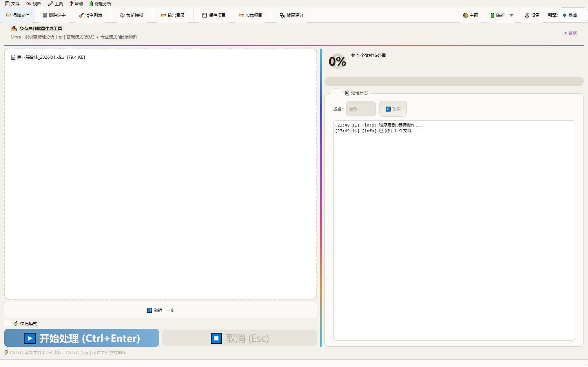
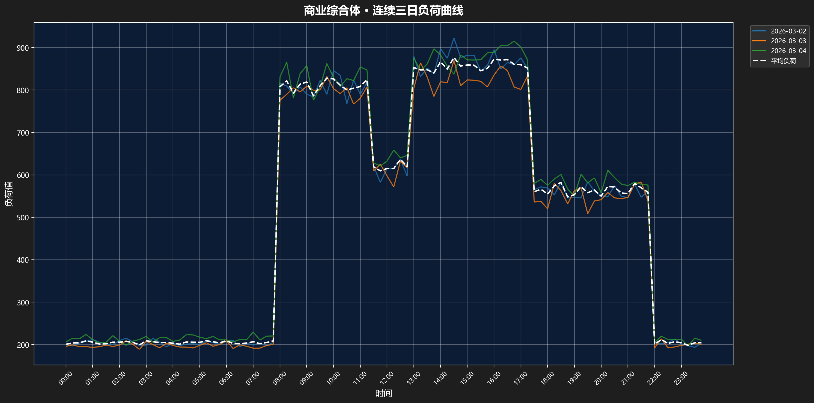
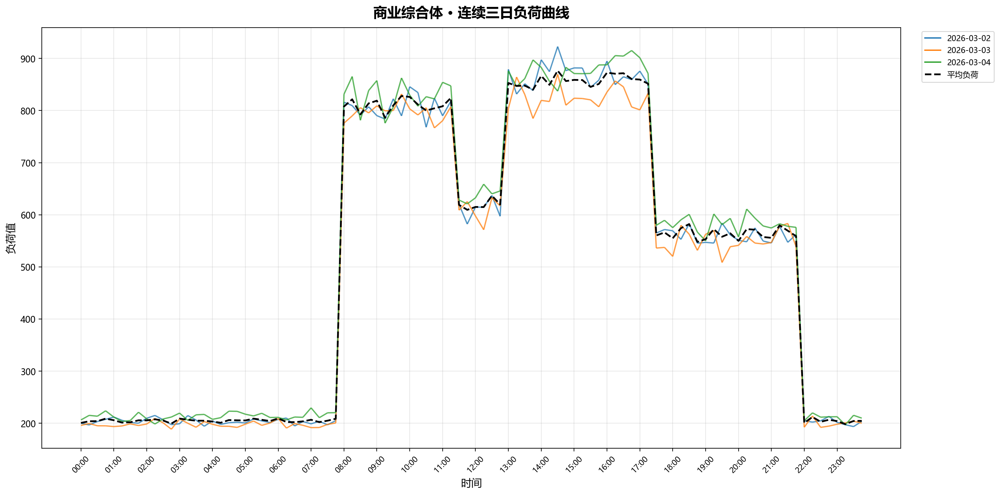
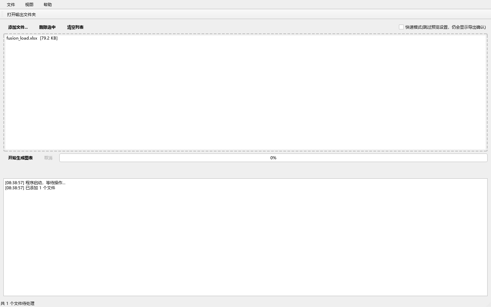

<div align="center">


# LoomGrid

**工商业储能测算工作台**
<sub><i>C&I Energy Storage Sizing Studio</i></sub>

<sub>把一条负荷曲线，织成一份可交付的储能方案</sub>

<br>

[](LICENSE)
[](https://www.python.org/)
[](https://www.qt.io/qt-for-python)


[](https://github.com/172629438/loomgrid/releases)
[](https://github.com/172629438/loomgrid/commits)

<br>

**[快速开始](#快速开始)** · **[该用哪个版本](#该用哪个版本)** · **[核心算法](#核心算法)** · **[怎么保证算得对](#怎么保证算得对)** · **[文档](#文档)** · **[参与贡献](CONTRIBUTING.md)**

</div>


<div align="center"><sub>负荷曲线 × 峰平谷电价分层 × 储能充放区间 —— 一张图说清这个工具在算什么</sub></div>

<div align="center">
<table>
<tr>
<td align="center" width="50%"></td>
<td align="center" width="50%"></td>
</tr>
<tr>
<td align="center"><sub><b>主工作台</b> · 拖入文件 → 自动识别列 → 批量生成</sub></td>
<td align="center"><sub><b>负荷模拟</b> · 25 行业参数 × 三层叠加引擎</sub></td>
</tr>
</table>
</div>


<div align="center"><sub>谷段充、尖峰放，SOC 全程在保护区间内 —— 这条动画由 <code>algorithms/</code> 里的真实算法驱动</sub></div>

---

<details>
<summary><b>目录（点开）</b></summary>

- [这是什么](#这是什么)
- [该用哪个版本](#该用哪个版本)
- [快速开始](#快速开始)
- [核心算法](#核心算法)
- [核心能力](#核心能力)
- [藏在细节里的设计](#藏在细节里的设计)
- [视觉与动效](#视觉与动效)
- [版本说明](#版本说明)
- [写给同行的话](#写给同行的话)
- [架构与设计](#架构与设计)
- [技术栈与环境](#技术栈与环境)
- [已知边界](#已知边界)
- [怎么保证算得对](#怎么保证算得对)
- [文档](#文档)
- [接下来](#接下来)
- [常见问题](#常见问题)
- [参与贡献](#参与贡献)
- [致谢](#致谢)
- [许可](#许可)

</details>

---

## 这是什么

> 一个储能工程师，为解放自己的重复劳动写出来的桌面工具。读进客户的用电曲线和当地分时电价，算清楚「装多大、怎么充放、能省多少、几年回本」。

不是演示 Demo。3.5 万行 Python + PySide6，96 个类。**不优雅，但真实**——包括走得通的路和绕过的弯。

### 你可能需要它，如果：

| 你的处境 | 这里有什么 |
|---|---|
| 刚接触储能测算，不知道容量怎么定 | 7 个可独立运行的算法模块，每个都能单独跑 |
| 想知道充放电空间到底怎么算 | `spaces.py`：给定曲线和电价时段，逐段算可充/可放 |
| 在选调度策略 | `dispatch.py`：贪心 / 逐日仿真 / 线性规划，三份实现同文件对照 |
| 要跟人解释「为什么是这个容量」 | `milp.py`：MILP 全局最优，含多设备选型与更换周期（Ultra 版才有） |
| 想验证自己的经济模型 | `finance.py`：NPV / IRR / 回收期 / LCOE，IRR 有二分法兜底 |
| 需要一条像样的曲线做测试 | `loadgen.py`：25 行业 × 省份基线 × 设备 Markov × 噪声平滑 |

### 和手工做方案比，差在哪

| 环节 | 手工 | 用这个 |
|---|---|---|
| 拉 8760 行负荷、拆日期时间 | Excel 公式 + 手工拖 | 拖进去自动识别列 |
| 按省份拆峰平谷时段 | 查政策、手填时段表 | 选省份自动加载 104 条已整理的电价 |
| 算充放空间 | 逐时段列公式，或凭经验拍 | 逐日 / 分段两种口径自动算 |
| 试不同容量 | 改一个参数重算一遍 | 敏感性表一次出 6 个容量点 |
| 出图 | 手调坐标轴、配色 | 深浅双主题批量出图 |
| 结果对不对 | 靠经验 | 12 项手算对拍 + 85 项回归 |

**它不替你做判断。** 峰谷价差取多少、循环按几次、需量按哪个口径——这些还得你自己定。工具的价值是把搬运那七成省下来，让你有时间想这三成。

---

## 该用哪个版本

**30 秒选完**：

| 你的情况 | 用这个 |
|---|---|
| 明天要交方案，要稳 | **[Fusion v2.3.4](https://github.com/172629438/loomgrid/releases/tag/fusion-v2.3.4)** |
| 功能越多越好，愿意跟着踩坑 | **[Ultra v3.2.8](https://github.com/172629438/loomgrid/releases/tag/ultra-v3.2.8)** |
| 想读源码，10k 行比 35k 行好读 | **[Fusion v2.3.4](https://github.com/172629438/loomgrid/releases/tag/fusion-v2.3.4)** |
| 想研究三层叠加引擎的完整实现 | **[Backup v2.29](https://github.com/172629438/loomgrid/releases/tag/backup-v2.29.0)** |
| 想看看真实项目的弯路长什么样 | **[Reference v2.29](https://github.com/172629438/loomgrid/releases/tag/reference-v2.29.0)** |
| 想看某个功能最早怎么写的 | **[Fusion v1.1 ~ v2.2](https://github.com/172629438/loomgrid/releases)** |

两个现役版本不是「新旧」，是**两条路线**：

| | **Fusion v2.3.4** | **Ultra v3.2.8** |
|---|---|---|
| 定位 | **生产推荐** | 测试版（功能最全） |
| 代码量 | 10,421 行 | 35,932 行 |
| 架构 | 另写一遍，流式处理 | 单文件全功能 |
| 吞吐 | Ultra 的三成 | 基准 |
| 内存占用 | 低 | 高 |
| MILP 全局规划 | — | ✓ |
| 四目标 Pareto | — | ✓ |
| 13 步综合诊断 | — | ✓ |
| 三层叠加负荷引擎 | 简化版 | 完整 |
| 13 个动效组件 | — | ✓ |
| 稳定性 | 高（跑得久） | 中（功能密度超过测试覆盖） |

> **为什么稳定版推荐的是行数少的那个**：Ultra v3.2.8 在 2026-10 这一轮同时塞进了 MILP、四目标 Pareto、13 步诊断、13 个动效组件、三层引擎回填和 30 余条缺陷修复；v3.2.1 修了 4 条口径、v3.2.2 修了数据接入层的表格式误判（含一条自加入起就 100% 失败的结算功能）。能力上限更高，踩坑概率也更高。这不是设计错了，是还没打磨完。

---

## 快速开始

<table>
<tr>
<td width="50%" valign="top">

**① 直接用（不装环境）**

到 [Releases](https://github.com/172629438/loomgrid/releases) 选你要的版本——**每个版本一个独立压缩包**，各 163.6 MB，解压后 366 MB，自带完整运行时，不需装 Python。

| 版本 | 适合 |
|---|---|
| [**Fusion v2.3.4**](https://github.com/172629438/loomgrid/releases/tag/fusion-v2.3.4) | **正式做方案**，稳定优先选它 |
| [**Ultra v3.2.8**](https://github.com/172629438/loomgrid/releases/tag/ultra-v3.2.8) | 功能最全，但在测试阶段，愿意一起踩坑就上 |
| [Backup v2.29](https://github.com/172629438/loomgrid/releases/tag/backup-v2.29.0) | Ultra 历史快照，含三层叠加引擎原文 |
| [Reference v2.29](https://github.com/172629438/loomgrid/releases/tag/reference-v2.29.0) | 早期分支，含占位方法，**不要做正式方案** |
| [Fusion v1.1 ~ v2.2](https://github.com/172629438/loomgrid/releases) | 考古、版本对比 |

`lib\` 目录必须和 exe 保持同级，不要单独把 exe 拎出来。

</td>
<td width="50%" valign="top">

**② 从源码跑**

```bash
pip install PySide6 numpy pandas scipy \
            matplotlib openpyxl ortools
python "负荷曲线批量生成Ultra.py"
```

按 `F1` 查看内置手册。

**③ 只看算法**（不装 GUI 依赖）

```bash
python examples/quickstart.py
```

零外部数据，七个步骤跑通全链路。

</td>
</tr>
</table>

---

## 核心算法

七个文件从 3.5 万行主程序里剥离，标准是：不依赖 GUI、不依赖全局状态、能单独 import 就跑。

| 模块 | 内容 | 行数 |
|---|---:|---:|
| [`periods.py`](algorithms/periods.py) | 电价时段归一化、类型词表映射、分段合并、价格序列 | 284 |
| [`spaces.py`](algorithms/spaces.py) | 充放电空间（逐日 / 分段两种口径） | 628 |
| [`dispatch.py`](algorithms/dispatch.py) | 贪心 / 逐日仿真 / 线性规划三种调度 | 736 |
| [`milp.py`](algorithms/milp.py) | MILP 容量规划（多设备选型 + 更换周期 + 需量电费） | 411 |
| [`finance.py`](algorithms/finance.py) | NPV / IRR / 回收期 / LCOE | 213 |
| [`loadgen.py`](algorithms/loadgen.py) | 三层叠加负荷生成引擎 | 263 |
| [`diagnostics.py`](algorithms/diagnostics.py) | 负荷指纹分析与行业匹配 | 561 |
| [`demo.py`](algorithms/demo.py) | 不看源码先看效果：七个模块各调用一遍 | — |

想直接看效果：`cd algorithms && python demo.py`。用现场构造的数据把七个模块跑一遍，不需要准备任何外部文件。

`examples/quickstart.py` 会算出一条不那么漂亮的结论——**容量不是越大越好，而且这一组参数下大头都不划算**：

| 容量 | 回收期 | NPV（6% / 15 年） | 说明 |
|---:|---:|---:|---|
| 500 kWh | 3.7 年 | +49.6 万 | 日循环上限 484 kWh 能吃满 |
| 800 kWh | 6.5 年 | +20.0 万 | ← 拐点：从这一档开始装不满 |
| 1000 kWh | 9.3 年 | −5.4 万 | 超过日循环上限 484 kWh |
| 1500 kWh | 22.3 年 | −68.8 万 | |
| 2000 kWh | 73.1 年 | −132.3 万 | |
| 3000 kWh | 不可回收 | −259.2 万 | |

注意最后两列：这组参数（750 元/kWh、0.88 元价差、330 天）下，只有 500–800 kWh 两档 NPV 为正。
示例想说明的是「瓶颈在负荷侧」——峰段可削量与谷段余量把日循环锁在 484 kWh，
装得再大也只能闲置。真实项目把峰谷价差、投资单价、利用天数换成实测值后，拐点位置会变。

每个模块的**问题、输入输出、核心逻辑、参数含义、踩过的坑** → [`algorithms/README.md`](algorithms/README.md)

---

## 核心能力

<table>
<tr><td width="20%"><b>数据接入</b></td><td>Excel/CSV 宽表批量读取 · 自动列类型识别（日期/时间/负荷/资产） · 跨文件映射规则复用</td></tr>
<tr><td><b>负荷处理</b></td><td>25 行业参数库 · 三层叠加模拟引擎 · 光伏降粒度对齐与净负荷合成 · 负荷指纹分析</td></tr>
<tr><td><b>储能测算</b></td><td>充放电空间（按容量/按需量两种电费模式） · 三套调度引擎 · MILP 精准规划 · 四目标 Pareto · 多场景扫描</td></tr>
<tr><td><b>经济诊断</b></td><td>NPV / IRR / LCOE / 动态回收期 · 月度电费结算对比 · 13 步综合诊断 · 循环退化建模</td></tr>
<tr><td><b>交付输出</b></td><td>Matplotlib 批量出图（深浅双主题） · HTML 报告与方案建议书 · 技术偏差表与配置清单</td></tr>
<tr><td><b>数据校验</b></td><td>导出清洗后的中间宽表（行=日期 / 列=时刻） · 在 Excel 里画折线图即可肉眼核对清洗结果 · 排查倍率错位、丢点、空值归零</td></tr>
</table>

---

## 藏在细节里的设计

下面这些不是功能列表上的条目。**它们都是被真实数据撞出来的**——某个客户的表打不开、某个省份的电价对不上、某次算出了一个不可能的负数——然后才补进去的一行行分支。

用的人不会注意到它们，除非它们不在。

### 一、读得进来：什么格式的表都能吃下

**编码五级回退**

```
utf-8-sig → gbk → gb18030 → gb2312 → latin1
```

现场导出的 CSV 编码五花八门：财务系统导 GBK，电表导 gb2312，老系统导 gb18030，还有人从网页复制粘进 Excel 存成 utf-8-sig。编码试错比报错好，所以一行不匹配就换下一个，五个都不行才认输。

**列名三级匹配**

强匹配（`有功功率` `需量` `load` `kw`）→ 弱匹配候补 → 全局相似度兜底。遇到没见过的列名，先用编辑距离算它跟已知列名的相似度，再让你确认。

**无功、电流、电压不会当负荷**

这是实际踩过的坑：一张电表导出表里同时有「正向有功功率」和「四象限无功功率」，两者列名都含“功率”，靠关键词很容易认错。所以在强匹配词表里把它们归为弱匹配，**优先级永远低于有功**。

**日期格式 100 倍加速**

常见格式先试一遍（`2026-10-01`、`2026/10/1`、`20261001`、Excel 序列号），都不中才退回通用的逐元素解析。实测两者差 100 倍——一張 3 万行的表，前者 0.2 秒，后者 20 秒。

**文件格式降级**

`.xlsx` 打不开试 `.pyxlsb`（二进制 Excel），CSV 引擎失败就换通用引擎 + 自动分隔符探测。

### 二、少让人填：能自动的绝不让你点

**宽表和示数表不需要选时间列**

普通表格要你指定哪一列是时间，但宽表的列名本身就是时间点（`0:00` `0:15` `0:30`…），示数表则是第一列时间、第一行日期。程序认得出这两种结构，**直接把时间选择器置灰**，不用你选。

**映射规则会自己记住**

第一次给某类表指定了列对应关系，后续结构相同的文件自动套用，不再弹窗问。一批 30 个格式一致的文件，只需映射一次。

**列头直接点**

预览窗口里不用先选“要设成哪种列”再选列，而是**直接在表格列头上点**——点第一次设为日期，再点设为负荷，带颜色标识。比下拉框快一个量级。

**时间写法三兼容**

输入框提示是 `例: 08:30 / 8.5 / 8 30`。三种写法都认：`08:30`、`8.5`（小时小数）、`8 30`（空格分隔）。

**全屏核对模式**

图表区可以隐藏侧边栏，全屏显示。核数据的时候看的就是图，不需要一圈控件围着。

### 三、算得靠谱：模型失败也有后路

**IQR 为零时用 MAD**

异常值检测默认用四分位距（IQR）。但如果一天里 90% 的采样点数值完全相同，IQR 就是 0，上下界会收缩成一个点，把所有正常波动都判成异常。所以当 IQR=0 时自动改用 MAD（中位数绝对偏差）。

**没有 scipy 就降级**

层次聚类默认用 scipy 的 `linkage`。如果用户环境里没装 scipy，自动退回自写的贪心凝聚——聚出来的结果没那么优，**但不会直接报错不干活**。

**非省会城市用晴空指数**

光伏模拟需要当地辐照数据。库里只有 31 个省会城市，用户填了“苏州”“宁波”这种非省会城市时，不会直接报“无数据”，而是按城市纬度算晴空指数做估算。

**多模型竞赛**

负荷预测不是一个模型硬跑到底，而是 Holt-Winters / SARIMA / STL / 朴素法四个同时跑，按回测误差自动选最优，附带置信区间和一句行动建议。

**异常日自动标记**

基于 MAD 距离找出异常日（设备故障、停电、节假日），可以剔除或替换成中位日。不处理的话，一个停电日的零负荷会把整月的平均值拉低。

### 四、不静默：出错要看得见

**浮点异常不再被吞**

一行 `np.seterr(all='raise')`。默认行为是警告后继续算，结果就是一个 `inf` 或 `nan` 悄悄传下去，最后画出个空图。改成 raise 之后，示数表差分除零这类错误会当场抛出，带堆栈。

**配置文件原子替换**

写配置时先写临时文件，再 `os.replace` 原子替换。跨文件系统时 `os.replace` 可能失败，那就退回 `shutil.move`。**断电或崩溃不会留下半个配置文件**——这一点在工控机上很重要。

**可选依赖全都可缺**

`loguru` 缺失降级到标准 `logging`；`chinese_calendar` 缺失就跳过节假日识别；`scipy` 缺失降级算法；`pyxlsb` 缺失就只支持 xlsx。**一个库没装，不应该让整个程序起不来。**

**色盲友好配色**

默认色板用 Wong 2011（Nature Methods）那套：蓝 `#0072B2`、橙 `#E69F00`、灰——对红绿色弱也能区分。数据图不是设计图，可读性优先于好看。

---

## 视觉与动效

> 「我不想只做一个无聊的程序员。」

界面上确实做了不少花里胡哨的东西。这块代码占的比重不低，也是**最想听别人提意见**的地方。

### 界面实拍

下面这几张都是**真跑出来的**：脚本造一份商业综合体年度电表数据（45 天 × 96 点，工作日夜峰、周末降 28%、5% 噪声），注入程序，等渲染稳定后直接抓控件。不 P 图、不摆拍。

**Ultra · 导入数据后**（左侧文件列表、右侧日志与环形进度）



**Ultra · 负荷曲线出图**（深色）



**Ultra · 负荷曲线出图**（浅色，带均值线）



**Fusion · 导入数据后**——两代产品的差别一眼能看出来：Fusion 是原生控件、无装饰，把力气全用在读表与算账上



> 截图已知一处瑕疵：Ultra 顶部大标题用了渐变画刷 + 扫光动效，静态帧抓下来是模糊的蓝带。真实运行时它是流动的。没为截图去改这行代码。

<table>
<tr><td width="26%"><code>WindowAnimator</code></td><td>窗口淡入与位置过渡</td></tr>
<tr><td><code>RippleButton</code></td><td>点击涟漪扩散</td></tr>
<tr><td><code>ParticleOverlay</code></td><td>粒子背景层</td></tr>
<tr><td><code>HslAnimator</code></td><td>HSL 色彩循环动画</td></tr>
<tr><td><code>BlueprintTransition</code></td><td>页面切换的蓝图描线过渡</td></tr>
<tr><td><code>MappingProgressTransition</code></td><td>文件映射进度过渡</td></tr>
<tr><td><code>SplashAnimation</code></td><td>启动画面</td></tr>
<tr><td><code>TourOverlay</code></td><td>首次使用引导浮层</td></tr>
<tr><td><code>ToastManager</code></td><td>轻提示队列（带自动清理）</td></tr>
<tr><td><code>AnimatedDialog</code></td><td>对话框弹出与收起</td></tr>
<tr><td><code>CircularProgressBar</code></td><td>环形进度指示</td></tr>
<tr><td><code>DropOverlay</code></td><td>拖放高亮层</td></tr>
<tr><td><code>SensitivitySliderPanel</code></td><td>敏感性实时滑块</td></tr>
</table>

底层用的是 `QPropertyAnimation` + `QEasingCurve`（27 处缓动曲线）+ `QParallelAnimationGroup`，没有引入额外的动画库。

**想听到三类反馈**：

1. **哪里卡了** —— 动效掉帧、动画重叠、窗口缩放时错位
2. **哪里多了** —— 哪个动效看着热闹但干扰操作，该删
3. **哪里该有却没有** —— 状态切换太硬、缺少反馈的地方

### 这些动效该怎么看

花里胡哨本身不是问题，**分寸**才是。工具类软件和展示类产品是两套标准：后者要让人「哇」，前者要让人「顺」。顺的标准是——用户感觉不到动画存在，只觉得操作不卡。

按这个标准，上面那 13 个组件分成三层：

<table>
<tr><th width="18%">层级</th><th width="40%">组件</th><th>理由</th></tr>
<tr>
<td><b>必要</b><br><sub>替用户理解状态</sub></td>
<td><code>CircularProgressBar</code> <code>ToastManager</code> <code>DropOverlay</code> <code>RippleButton</code> <code>AnimatedDialog</code></td>
<td>进度必须可见、结果必须有反馈、拖放目标必须高亮、点击必须确认。这些不是装饰，是在替用户回答「刚才那下成了吗」。</td>
</tr>
<tr>
<td><b>可接受</b><br><sub>但必须有刹车</sub></td>
<td><code>SplashAnimation</code> <code>TourOverlay</code> <code>BlueprintTransition</code> <code>MappingProgressTransition</code></td>
<td>启动画面超过 1.5 秒就该砍；引导层必须 ESC 能退；页面切换控制在 250ms 内——超过 300ms 人会觉得「卡了一下」而不是「有个过渡」。</td>
</tr>
<tr>
<td><b>容易过度</b><br><sub>纯装饰，建议可关</sub></td>
<td><code>ParticleOverlay</code> <code>HslAnimator</code> <code>WindowAnimator</code></td>
<td>粒子背景在静态分析时持续吃 GPU，笔记本上会听见风扇；色彩循环看久了晕；窗口淡入第一次觉得高级，第二次启动就嫌慢。</td>
</tr>
</table>

**一条铁律，比上面所有建议都重要**：任何一帧动画期间，用户的操作必须能被接收。动效阻塞输入是工具类软件最致命的错——人不会觉得好看，只会觉得卡死。

对工具类软件来说，动效的分寸很难拿。这个分寸我一个人把不住，需要更多人的眼睛。

---

## 版本说明

同一工具的两条技术路线加若干历史快照。**判断版本看文件头部的 `ULTRA_VERSION`，不要看文件名**——历史上目录名当发布批次用过，`v1.4` 目录里装的是 v2.1。

### 现役版本

| 文件 | 内部版本 | 行数 | 定位 | 状态 |
|---|---|---:|---|---|
| `负荷曲线批量生成工具 Pro 融合版 (v2.3).py` | v2.3 | ~10.4k | **生产推荐**，要结果稳就选它 | 稳定 |
| `负荷曲线批量生成Ultra.py` | v3.2.2 | ~35.9k | 功能最全，**仍在测试**，新功能与新动效密集 | 测试中 |

> **为什么稳定版推荐的是「旧」版本？**
>
> Ultra v3.2 是功能最全的一条线，但它在 2026-10 这一轮里同时塞进了太多东西：MILP 全局规划、四目标 Pareto、13 步诊断、13 个动效组件、三层叠加引擎回填、30 余条缺陷修复。功能堆叠的密度超过了测试覆盖的增长速度——GUI 点击路径至今没有自动化回归，交付前只做过靶向断言和抽样启动测试。
>
> 结果就是：**能力上限更高，踩坑概率也更高**。明天就要交方案的场景，用 Fusion v2.3 更稳——它只有 10,421 行，功能是 Ultra 的子集，但每条路径都跑了很久。
>
> Ultra 的问题不是设计错了，是还没打磨完。想一起打磨，非常欢迎——这正是这个仓库开源的意义。

### 历史快照

| 文件 | 版本 | 说明 |
|---|---|---|
| `备份程序.py` | v2.29+ | Ultra 历史快照，**保有三层叠加引擎原文**，主线丢了这功能时从它回填 |
| `参考程序.py` | v2.29 | 更早分支，含一批未实现的占位方法（见已知边界） |
| `legacy/` 下 8 个文件 | v1.1 ~ v2.2 | 融合版完整演进史 |

<details>
<summary><b>点开看：各版本已知缺陷</b></summary>

| 版本 | 已知问题 |
|---|---|
| **v1.1 ~ v1.4** | 无储能测算能力；配置格式与后续不兼容；中文文件名在部分系统上乱码 |
| **v2.0 ~ v2.1** | 列映射只支持单文件，跨文件要重来；无 MILP |
| **v2.2** | 双引擎架构雏形，professional 引擎不稳定；配置迁移有丢失风险 |
| **v2.3（融合版）** | 流式处理，大批量吞吐只有 Ultra 三成；部分高级分析未实现 |
| **v2.29（参考程序）** | 含 10 个占位方法，内部用 `× 0.85`、`容量 × 750` 这类常数冒充测算结果，**不要用于正式方案** |
| **v3.2（Ultra）** | 单文件 3.5 万行技术债；GUI 点击路径无自动化回归；2 条已知未修问题见[缺陷修复报告](docs/缺陷修复报告.md) |

每个版本的演进脉络与缺陷细节 → [`legacy/README.md`](legacy/README.md) · [`docs/版本演进.md`](docs/版本演进.md)

</details>

---

## 写给同行的话

<details>
<summary><b>点开看：这个项目为什么存在</b></summary>

我不是程序员。我的本职是储能解决方案工程师。

这个程序是被逼出来的。日复一日的方案测算里，大量时间花在重复劳动上：拉 8760 行负荷数据、按省份拆分时段、用 Excel 拼公式、一遍遍核对需量。**一份方案里真正需要判断的部分可能不到三成，剩下七成是搬运和格式化。**

所以我把这些搬运写成了代码。

如果这个工具能帮到同类岗位的兄弟——哪怕只是把你从手工拉数据里解救出来一两个小时，让你有空去多学一点储能系统的真东西，把方案做得更透一点——那它就值了。

它也希望能帮到在开发同类系统的技术人员：`algorithms/` 下那七个模块，充放空间怎么算、三种调度怎么对照、MILP 怎么建模、IRR 不收敛怎么兜底，都是实际跑出来的，不是教科书推导。

但一个人的力量总是有限的。全栈开发加上深度测试，我确实快撑不住了，手上还有其他项目要做。所以选择了开源：

> **希望它帮到大家，也希望更多人来帮我把它改好。**
>
> 用下来哪里别扭、哪个数算得不对、哪个场景没覆盖到——提个 Issue 就行。行业里的真实场景，比任何算法设计都更能磨好一个工具。

</details>

<details>
<summary><b>点开看：这个项目是怎么写出来的（DeepSeek 与 Hana Agent）</b></summary>

**第一阶段：D 老师（DeepSeek 网页版免费对话），2026-05 ~ 2026-09**

最早就是我和 D 老师两个人，我提需求、他写代码，一段段贴过去、贴回来。`legacy/` 里 v1.1 到 v2.3 那八个版本，基本就是这么聊出来的。

天花板很明确：**上下文窗口**。单文件涨到一万行之后，每次对话都要重新贴大段代码，聊到后面模型记不住前面的约定，改 A 处崩 B 处。

**第二阶段：[Hana Agent](https://openhanako.com) + DeepSeek API（2026-10 至今）**

Hana 是本地运行的 AI Agent 平台：能直接读写工作目录的文件、执行命令、跑测试、管理技能库，还有跨会话长期记忆。开发方式从「贴代码给它看」变成「它自己读文件、自己改、自己跑验证」。

这个仓库里能看到它干的具体活：算法模块的 AST 剥离与依赖闭包解析、31 条缺陷的逐条定位与修复、350 行死代码考古、无头渲染出的界面截图。

| 做 AI 辅助开发的痛点 | Hana 怎么解 |
|---|---|
| 网页对话记不住长上下文 | 本地文件系统 + 跨会话记忆，代码就在它眼睛底下 |
| 改完不知道对不对 | 能自己跑脚本验证，把实际输出贴回来 |
| 一个人维护不动大项目 | 能拆分任务、并行处理、写文档、做审计 |

**署名三个**：

> **需求、判断、业务知识** —— 我
> **v1.1 ~ v2.3 的代码实现** —— DeepSeek（网页版对话）
> **v3.0 之后的架构重构、缺陷审查、文档工程** —— Hana Agent + DeepSeek API

</details>

---

## 架构与设计


<details>
<summary><b>点开看：为什么坚持单文件</b></summary>

**一半是强迫症。** 天秤座，看不得散落一地的文件。一个 `.py` 就是一个完整的东西，这个念头很难抗拒。

**另一半是实用。** 拷一个文件到任何装了 Python 的机器上就能跑——不用管包结构、不用管相对导入、不用管 `__init__.py`。给同行发过去时，一个附件解决，不是一段「先建目录再 pip install」的说明。

**代价也说清楚**：35.8k 行堆在一个文件里，没有模块边界，IDE 跳转慢，两个人同时改会冲突。这是真实的技术债，不是美德。

所以 `algorithms/` 目录是这个理念的第一次让步——把能抽的都抽出去，剩下的 GUI 和业务编排继续维持单文件。将来如果要彻底拆，`algorithms/` 就是现成的起点。

</details>

<details>
<summary><b>点开看：三个关键设计选择与理由</b></summary>

- **三套调度引擎并存**：不是冗余。贪心用于秒级预览，逐日仿真用于看 SOC 轨迹，LP 用于求最优。三者结果要能互相对照，这是验算手段。
- **MILP 作为可选替代**：快速排序法给出候选，MILP 在候选空间里求全局最优。没有 OR-Tools 时自动降级，不阻塞主流程。
- **领域层不依赖 GUI**：这是 `algorithms/` 能抽出来的前提。充放空间、调度、财务计算全部接受纯数据（DataFrame / dict / list），不碰任何 Qt 对象。

</details>

---

## 技术栈与环境

| 层 | 用什么 | 版本要求 |
|---|---|---|
| 语言 | Python | 3.10+（开发用 3.12 / 3.14） |
| GUI | PySide6（Qt 6） | 6.5+ |
| 数值 | numpy / pandas / scipy | — |
| 绘图 | matplotlib | 3.7+ |
| Excel | openpyxl | — |
| 优化求解 | OR-Tools | 可选，缺了自动降级到快速排序法 |
| 打包 | cx_Freeze | 只在需要重新出 exe 时用 |

**不装 Python 也能用**：Releases 里的包自带完整运行时（Python + 全部依赖，解压后 366 MB），解压即用。

**只想跑算法部分**：numpy / pandas / scipy 三个就够，不用装 Qt。`examples/quickstart.py` 和 `algorithms/demo.py` 都只需要这三个。

### 项目规模

<div align="center">

| 现役代码 | 算法模块 | 历史快照 | 已修缺陷 | 验证断言 |
|:---:|:---:|:---:|:---:|:---:|
| **89,363** 行 | **7** 个 | **8** 个 | **31** 条 | **97** 项 |
| Ultra 35,932 / Backup 32,216<br>Reference 31,794 / Fusion 10,421 | 3,096 行<br>均不依赖 GUI | v1.1 ~ v2.3<br>仅做考古 | 致命 5 / 高危 9<br>中危 11 / 低危 6 | 12 项手算对拍<br>85 项回归 |

</div>

---

## 已知边界

- **`参考程序.py` 里有一批未实现的占位方法**。例如月度结算里的 `有储能电费 = 无储能电费 × 0.85`、快速测算里的 `投资 = 容量 × 750`。这些常数是当年为了先跑通界面拍的，不是测算结果。Ultra 里未采纳这些方法。
- **单文件 3.5 万行**，没有单元测试框架，验证靠脚本巡检（85 项回归 + 12 项算法手算对拍，见 [`tests/`](tests/) 与[缺陷修复报告](docs/缺陷修复报告.md)）。
- **测算依赖输入质量**。工具不校验外部数据真实性，列映射选错会一路错到底。
- **GUI 交互流程没有自动化回归测试**。核心算法有，界面点击路径靠人工。
- **Ultra v3.2.8 处于测试阶段**。功能最全，但新增功能密集、动效组件多，稳定性不如 Fusion v2.3.4。正式交付优先用 Fusion。
- **`legacy/` 里的历史版本仅供考古**，配置格式与现役版本不兼容，不建议使用。

---

## 怎么保证算得对

工具类软件最怕的不是功能少，是**算错了还看起来像对的**。这个项目用四层办法防这件事。

### 一、能手算的，必须对得上

[`tests/verify_algorithms_math.py`](tests/verify_algorithms_math.py) 用**可以手算的样例**逐个对拍，共 12 项：

| 项目 | 手算期望 | 工具实得 |
|---|---:|---:|
| NPV：20 万 × 10 年 @ 8% | 1,342,016.28 | 1,342,016.28 |
| 扣 100 万投资后的 NPV | 342,016.28 | 342,016.28 |
| 静态回收期：100 万 / 20 万 | 5.00 年 | 5.00 年 |
| IRR（无衰减） | 15.0984% | 15.0984% |
| 充电空间（平坦 500 kW / 变压器 800 kVA） | 3000 kWh | 3000 kWh |
| 放电空间（峰段 5 h） | 2325 kWh | 2325 kWh |
| 负荷超变压器时的充电空间 | 0 | 0 |
| 24 小时价格序列逐点核对 | 谷/平/峰分段 | 逐点一致 |
| 跨午夜 22:00→6:00 拆分 | 8 小时 | 8 小时 |
| 两条空间计算路径一致性 | 相同 | 相同 |
| 无价差时 LP 收益 | 0 | 0 |
| 有价差时 LP 收益 | ≤ 384.75 | 370.89 |

跑法：

```bash
python tests/verify_algorithms_math.py
```

这张表本身也抓过虫。写它的时候我把期望值算错了三次（忘了 IRR 默认带 2% 衰减、Series 用日期做索引、初始 SOC 里那 250 kWh 是免费能量），每次都是我的测试错、程序对。**所以它不只验程序，也在验写测试的人。**它不只是验程序，也在验写测试的人。**

### 二、改过的地方，必须有回归

`tests/` 下另有 5 套回归脚本，覆盖历次修复的 31 条缺陷，共 85 项断言。每改一处测算相关代码就跑一遍，改坏了当场红。

### 三、算不出来的，如实写出来

[`docs/缺陷修复报告.md`](docs/缺陷修复报告.md) 里单列了一节「未验证的部分」：GUI 点击路径、模态对话框、非 Windows 平台。**没验的就是没验，不假装验过。**

### 四、不放心就自己看一眼：导出验证表

程序里有一个按钮叫 **「📤 导出中间宽表 (检查数据透视)」**，在「输出设置」标签页。

点它，会把当前分组**清洗后**的数据导成一张 Excel，并自动打开：

```
中间宽表_表号_年月.xlsx

        00:00   00:15   00:30   ...   23:45
10-01   512.3   508.1   505.7   ...   480.2
10-02   498.6   495.2   492.8   ...   476.5
...
```

**这张表就是程序内部真正在用的那份数据**——行是日期，列是时刻，每格一个采样点的负荷值（kW）。不管原件是长表、宽表还是累计示数表，程序把它洗成什么样，这张表就是什么样。

拿到它之后，可以做三件事验程序：

**一、画一条折线图看形状对不对**

选中整片数据 → 插入 → 折线图。正常的一天应该是「白天高、夜里低」的连续曲线。如果出现：

- 锯齿状跳变 → 某几个采样点解析错了
- 突然归零 → 空值被当成 0 填进去了
- 平得像一条直线 → 某一列被重复读了

**二、挑一天跟原始表对一遍**

随便找一天，把原件里那 96 个点跟这张表同一行逐个对。数字应该一模一样——**如果差了一个固定倍数（比如都是 100 倍），说明互感器倍率没设置对**。这是实际项目里最常碰到的错。

**三、看有没有丢点**

一张完整的表：15 分钟粒度应该是 96 列，行数等于当月实际天数。少列说明某些时间点被跳过，少行说明某些日期没读到。行数列数不对，后面的充放空间和容量推荐全建在沙子上。

**为什么要专门做这个功能**

数据清洗是整个流程里**最容易出错、又最不容易发现**的一步。长表转宽表、示数表差分转功率、跨午夜拆分、缺采样点补齐——这些处理做错了，程序不会报错，只会安静地画出一条错误的曲线，然后基于它算出一个错误的容量。

**你看着这张表画出来的折线图，是唯一能直接发现这类错误的东西。** 其他验证手段（单元测试、手算对拍）验的是算法本身，验不了「你这份数据到底读对没有」。

---

## 文档

| 文档 | 内容 |
|---|---|
| [`docs/深度理解报告.md`](docs/深度理解报告.md) | 七层架构、端到端调用链、充放电空间的物理定义、31 条风险清单 |
| [`algorithms/README.md`](algorithms/README.md) | 七个算法模块的原理、公式、参数含义与踩过的坑 |
| [`docs/版本演进.md`](docs/版本演进.md) | 四版本差异、特性迁移史、三次特性丢失与回填记录 |
| [`docs/缺陷修复报告.md`](docs/缺陷修复报告.md) | 31 条缺陷的定位、修法与验证证据（97 项断言） |

---

## 接下来

不是承诺，是方向。想参与的话这里有三个层次的入口。

### 已经在做

- **电价政策库持续校准** —— 31 个省级行政区、共 104 条省市电价时段是从公开政策整理的，政策一调就得跟。这块永远需要人
- **算法交叉验证** —— 用独立工具跑同一组数据，比对结果差异
- **边界场景覆盖** —— 脏数据、乱列名、跨年、多资产、光伏倒送

### 打算做

- **GUI 路径的自动化回归** —— 现在核心算法有 97 项断言兜底，界面点击路径全靠人工。想用 pytest-qt 把主流程串起来，但模态对话框是硬骨头
- **单文件的渐进拆分** —— `algorithms/` 是第一步。下一步想把数据加载层和配置层也独立出去，GUI 和业务编排最后再动
- **行业参数库改成数据文件** —— 25 个行业的负荷特征现在写在代码里，挪成 YAML 之后，懂行业的人不用会 Python 也能贡献

### 想清楚但没动手

- **Web 版** —— 桌面单文件的价值就在「拷过去就能跑」，改成 B/S 要丢掉这个优势。除非有多人协作的真实需求，否则不做
- **多语言界面** —— 目前只有中文。如果要，得先把所有硬编码字符串抽出来

---

## 常见问题

**为什么坚持单文件？**

一半强迫症（天秤座），一半实用——拷一个 `.py` 到装了 Python 的机器就能跑。代价写在[架构与设计](#架构与设计)里，不掩饰：35.8k 行没有模块边界，IDE 跳转慢。

**为什么 exe 有 164 MB？**

Python 运行时 + numpy + pandas + scipy + matplotlib + Qt 五件套，解压后 366 MB。这是 Python 打包程序的固有成本，不是塞了多余东西。11 个版本共用同一套运行时，所以加起来才 1.76 GB 而不是 4.9 GB。

**为什么 SOC 下限定在 5%，不是 0% 或 10%？**

历史上三个值在打架：全局配置写 0%、贪心算法写 5%、日仿真和雨流计数写 10%。统一时选了 5%——LFP 电芯放空到 0% 会加速衰减，工商业储能产品普遍留 5% 保护带。这个选择直接影响推荐容量：同一日需求下，比按 0% 口径算出来的**安装容量约多 5.6%**。

**支持 Mac / Linux 吗？**

源代码可以跑——PySide6 本身就是跨平台的。但没有打包，也没在非 Windows 环境实测过。想用的话自己 `pip install` 后运行，遇到问题提 Issue。

**exe 被杀毒软件报了，怎么办？**

打包的 Python 程序没有代码签名，国内杀软经常误报（尤其是对 `python3xx.dll` 的启发式规则）。加白名单即可。文件本身没有任何联网代码，源码就在仓库里，可以自己核对。

**启动要好几秒，正常吗？**

正常。首次启动要把 Python 运行时和依赖加载进内存，3–8 秒。如果超过 30 秒还没反应，大概率是杀软在扫 `lib\` 里的三千多个文件。

**界面中文显示成方框，或者导出的 CSV 乱码？**

两种不同的原因：界面方框是系统缺中文字体（装「微软雅黑」即可）；CSV 乱码是 Excel 默认用 GBK 打开 UTF-8 文件，导入时手动选 UTF-8。

**双击 exe 提示找不到模块？**

`lib\` 目录必须和 exe 在同一层。只把 exe 复制到别处是跑不起来的。

**程序会把我的数据传出去吗？**

不会。整个程序没有任何网络请求代码，唯一的外链是 JRC PVGIS（欧盟光伏数据库）的公开接口，而且只在主动点「获取光伏数据」时才调用。负荷数据、电价配置、测算结果全部留在本机。

**为什么 Fusion 版功能比 Ultra 少？**

因为它是**另写一遍**，不是裁剪。10,421 行对 35,932 行，流式处理、内存占用低、启动快，代价是吞吐只有 Ultra 三成、部分高级分析没实现。想读主流程代码的话，它比 Ultra 好读得多。

**为什么有些历史版本反而是「坏」的？**

因为它们是真实的历史，不是整理过的示例。`Reference-v2.29` 里有 10 个用常数冒充测算结果的占位方法——当年为了先跑通界面这么写的，后来没删干净。留着是为了让人看到这个项目真实的成长过程，包括走过的弯路。

---

## 参与贡献

欢迎提 Issue、提 PR、提需求。具体见 [`CONTRIBUTING.md`](CONTRIBUTING.md)。

我最想要的三类帮助：

1. **电价政策的准确性** —— 31 个省级行政区、共 104 条省市电价时段是从公开政策整理的，但政策会调整。发现某省时段过时了，告诉我。
2. **算法的交叉验证** —— 如果你有独立的测算工具，跑同一组数据对一下结果，差异就是线索。
3. **真实场景的边界情况** —— 数据脏、列名乱、跨年、多资产、光伏倒送，这些真实世界的坑比算法本身更需要覆盖。

---

## 致谢

[DeepSeek](https://www.deepseek.com/)（代码实现） · [Hana Agent](https://openhanako.com)（开发环境） · [OR-Tools](https://developers.google.com/optimization)（MILP 求解器） · [JRC PVGIS](https://re.jrc.ec.europa.eu/)（光伏数据参考） · 所有提 Issue 和 PR 的同行

---

## 许可

[MIT License](LICENSE)。用得上就拿去用，改了欢迎回来说一声。
