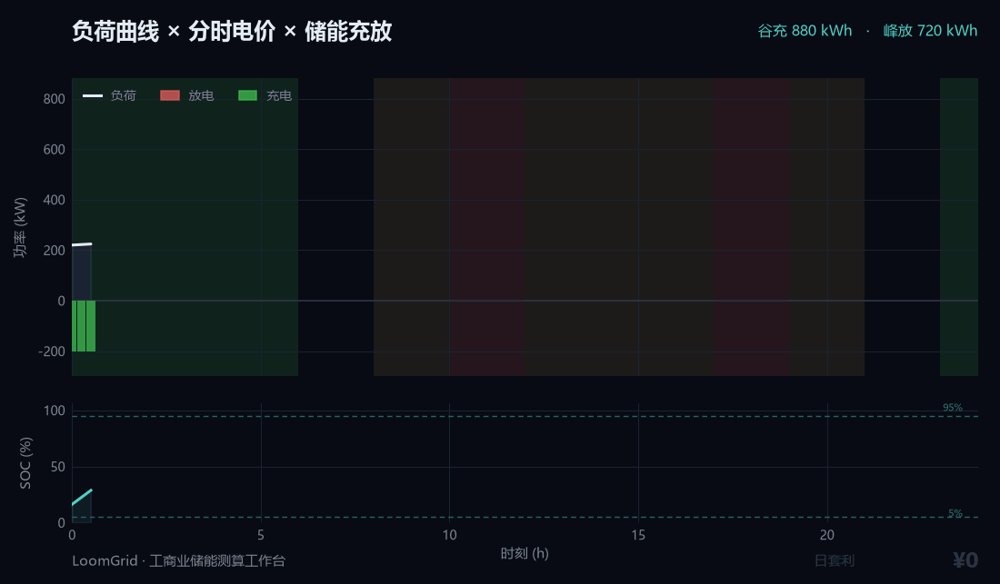
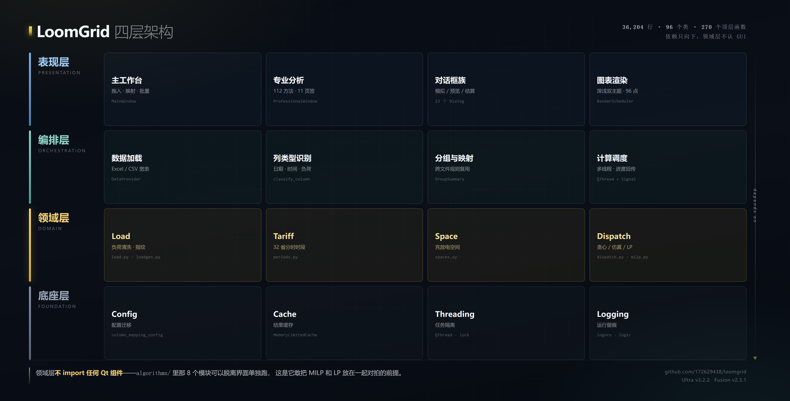

<div align="center">


# LoomGrid

**工商业储能测算工作台**
*C&I Energy Storage Sizing Studio*

把一条负荷曲线，织成一份可交付的储能方案。

[快速开始](#快速开始) · [核心算法](#核心算法) · [版本说明](#版本说明) · [已知边界](#已知边界) · [参与贡献](CONTRIBUTING.md)

</div>


<div align="center">
<table>
<tr>
<td align="center" width="50%"></td>
<td align="center" width="50%"></td>
</tr>
<tr>
<td align="center"><sub><b>主工作台</b> · 拖入文件 → 自动识别列 → 批量生成</sub></td>
<td align="center"><sub><b>负荷模拟</b> · 25 行业参数 × 三层叠加引擎</sub></td>
</tr>
</table>
</div>



<div align="center"><sub>谷段充、尖峰放，SOC 全程在保护区间内 —— 这条动画由 <code>algorithms/</code> 里的真实算法驱动</sub></div>

---

## 这是什么

> 一个储能工程师，为解放自己的重复劳动写出来的桌面工具。读进客户的用电曲线和当地分时电价，算清楚「装多大、怎么充放、能省多少、几年回本」。

不是演示 Demo。3.5 万行 Python + PySide6，96 个类。**不优雅，但真实**——包括走得通的路和绕过的弯。

### 你可能需要它，如果：

| 你的处境 | 这里有什么 |
|---|---|
| 刚接触储能测算，不知道容量怎么定 | 7 个可独立运行的算法模块，每个都能单独跑 |
| 想知道充放电空间到底怎么算 | `spaces.py`：给定曲线和电价时段，逐段算可充/可放 |
| 在选调度策略 | `dispatch.py`：贪心 / 逐日仿真 / 线性规划，三份实现同文件对照 |
| 要跟人解释「为什么是这个容量」 | `milp.py`：MILP 全局最优，含多设备选型与更换周期 |
| 想验证自己的经济模型 | `finance.py`：NPV / IRR / 回收期 / LCOE，IRR 有二分法兜底 |
| 需要一条像样的曲线做测试 | `loadgen.py`：25 行业 × 省份基线 × 设备 Markov × 噪声平滑 |

---

## 快速开始

<table>
<tr>
<td width="50%" valign="top">

**① 直接用（不装环境）**

到 [Releases](https://github.com/172629438/loomgrid/releases) 下载 **`LoomGrid-Suite-win64.zip`**（171 MB），解压双击。

包里含 **12 个版本**，共用一套运行时（解压后 452 MB）：

| 可执行文件 | 适合 |
|---|---|
| `LoomGrid-Ultra-v3.2.exe` | 正式做方案，功能最全 |
| `LoomGrid-Fusion-v2.3.exe` | 快速试算、读主流程 |
| `LoomGrid-Backup-v2.29.exe` | Ultra 历史快照，含三层叠加引擎原文 |
| `LoomGrid-Reference-v2.29.exe` | 早期分支，含占位方法，**不要做正式方案** |
| `LoomGrid-Fusion-v1.1` ~ `v2.2` | 考古、版本对比 |

不需要装 Python。`lib\` 目录必须和 exe 保持同级，不要单独移走 exe。

</td>
<td width="50%" valign="top">

**② 从源码跑**

```bash
pip install PySide6 numpy pandas scipy \
            matplotlib openpyxl ortools
python "负荷曲线批量生成Ultra.py"
```

按 `F1` 查看内置手册。

**③ 只看算法**（不装 GUI 依赖）

```bash
python examples/quickstart.py
```

零外部数据，七个步骤跑通全链路。

</td>
</tr>
</table>

---

## 核心算法

七个文件从 3.5 万行主程序里剥离，标准是：不依赖 GUI、不依赖全局状态、能单独 import 就跑。

| 模块 | 内容 | 行数 |
|---|---:|---:|
| [`periods.py`](algorithms/periods.py) | 电价时段归一化、类型词表映射、分段合并、价格序列 | 283 |
| [`spaces.py`](algorithms/spaces.py) | 充放电空间（逐日 / 分段两种口径） | 618 |
| [`dispatch.py`](algorithms/dispatch.py) | 贪心 / 逐日仿真 / 线性规划三种调度 | 730 |
| [`milp.py`](algorithms/milp.py) | MILP 容量规划（多设备选型 + 更换周期 + 需量电费） | 410 |
| [`finance.py`](algorithms/finance.py) | NPV / IRR / 回收期 / LCOE | 212 |
| [`loadgen.py`](algorithms/loadgen.py) | 三层叠加负荷生成引擎 | 262 |
| [`diagnostics.py`](algorithms/diagnostics.py) | 负荷指纹分析与行业匹配 | 561 |

`examples/quickstart.py` 会算出一条漂亮的结论——**容量不是越大越好**：

| 容量 | 回收期 | |
|---:|---:|---|
| 500 kWh | 3.7 年 | |
| 800 kWh | 3.7 年 | ← 最优 |
| 1000 kWh | 5.0 年 | 超过日循环上限 726 kWh |
| 1500 kWh | 9.3 年 | |
| 2000 kWh | 16.5 年 | |
| 3000 kWh | 73.1 年 | |

每个模块的**问题、输入输出、核心逻辑、参数含义、踩过的坑** → [`algorithms/README.md`](algorithms/README.md)

---

## 核心能力

<table>
<tr><td width="20%"><b>数据接入</b></td><td>Excel/CSV 宽表批量读取 · 自动列类型识别（日期/时间/负荷/资产） · 跨文件映射规则复用</td></tr>
<tr><td><b>负荷处理</b></td><td>25 行业参数库 · 三层叠加模拟引擎 · 光伏降粒度对齐与净负荷合成 · 负荷指纹分析</td></tr>
<tr><td><b>储能测算</b></td><td>充放电空间（按容量/按需量两种电费模式） · 三套调度引擎 · MILP 精准规划 · 四目标 Pareto · 多场景扫描</td></tr>
<tr><td><b>经济诊断</b></td><td>NPV / IRR / LCOE / 动态回收期 · 月度电费结算对比 · 13 步综合诊断 · 循环退化建模</td></tr>
<tr><td><b>交付输出</b></td><td>Matplotlib 批量出图（深浅双主题） · HTML 报告与方案建议书 · 技术偏差表与配置清单</td></tr>
</table>

---

## 视觉与动效

> 「我不想只做一个无聊的程序员。」

界面上确实做了不少花里胡哨的东西。这块代码占的比重不低，也是**最想听别人提意见**的地方。

<table>
<tr><td width="26%"><code>WindowAnimator</code></td><td>窗口淡入与位置过渡</td></tr>
<tr><td><code>RippleButton</code></td><td>点击涟漪扩散</td></tr>
<tr><td><code>ParticleOverlay</code></td><td>粒子背景层</td></tr>
<tr><td><code>HslAnimator</code></td><td>HSL 色彩循环动画</td></tr>
<tr><td><code>BlueprintTransition</code></td><td>页面切换的蓝图描线过渡</td></tr>
<tr><td><code>MappingProgressTransition</code></td><td>文件映射进度过渡</td></tr>
<tr><td><code>SplashAnimation</code></td><td>启动画面</td></tr>
<tr><td><code>TourOverlay</code></td><td>首次使用引导浮层</td></tr>
<tr><td><code>ToastManager</code></td><td>轻提示队列（带自动清理）</td></tr>
<tr><td><code>AnimatedDialog</code></td><td>对话框弹出与收起</td></tr>
<tr><td><code>CircularProgressBar</code></td><td>环形进度指示</td></tr>
<tr><td><code>DropOverlay</code></td><td>拖放高亮层</td></tr>
<tr><td><code>SensitivitySliderPanel</code></td><td>敏感性实时滑块</td></tr>
</table>

底层用的是 `QPropertyAnimation` + `QEasingCurve`（27 处缓动曲线）+ `QParallelAnimationGroup`，没有引入额外的动画库。

**想听到三类反馈**：

1. **哪里卡了** —— 动效掉帧、动画重叠、窗口缩放时错位
2. **哪里多了** —— 哪个动效看着热闹但干扰操作，该删
3. **哪里该有却没有** —— 状态切换太硬、缺少反馈的地方

### 这些动效该怎么看

花里胡哨本身不是问题，**分寸**才是。工具类软件和展示类产品是两套标准：后者要让人「哇」，前者要让人「顺」。顺的标准是——用户感觉不到动画存在，只觉得操作不卡。

按这个标准，上面那 13 个组件分成三层：

<table>
<tr><th width="18%">层级</th><th width="40%">组件</th><th>理由</th></tr>
<tr>
<td><b>必要</b><br><sub>替用户理解状态</sub></td>
<td><code>CircularProgressBar</code> <code>ToastManager</code> <code>DropOverlay</code> <code>RippleButton</code> <code>AnimatedDialog</code></td>
<td>进度必须可见、结果必须有反馈、拖放目标必须高亮、点击必须确认。这些不是装饰，是在替用户回答「刚才那下成了吗」。</td>
</tr>
<tr>
<td><b>可接受</b><br><sub>但必须有刹车</sub></td>
<td><code>SplashAnimation</code> <code>TourOverlay</code> <code>BlueprintTransition</code> <code>MappingProgressTransition</code></td>
<td>启动画面超过 1.5 秒就该砍；引导层必须 ESC 能退；页面切换控制在 250ms 内——超过 300ms 人会觉得「卡了一下」而不是「有个过渡」。</td>
</tr>
<tr>
<td><b>容易过度</b><br><sub>纯装饰，建议可关</sub></td>
<td><code>ParticleOverlay</code> <code>HslAnimator</code> <code>WindowAnimator</code></td>
<td>粒子背景在静态分析时持续吃 GPU，笔记本上会听见风扇；色彩循环看久了晕；窗口淡入第一次觉得高级，第二次启动就嫌慢。</td>
</tr>
</table>

**一条铁律，比上面所有建议都重要**：任何一帧动画期间，用户的操作必须能被接收。动效阻塞输入是工具类软件最致命的错——人不会觉得好看，只会觉得卡死。

对工具类软件来说，动效的分寸很难拿。这个分寸我一个人把不住，需要更多人的眼睛。

---

## 版本说明

同一工具的两条技术路线加若干历史快照。**判断版本看文件头部的 `ULTRA_VERSION`，不要看文件名**——历史上目录名当发布批次用过，`v1.4` 目录里装的是 v2.1。

### 现役版本

| 文件 | 内部版本 | 行数 | 定位 | 状态 |
|---|---|---:|---|---|
| `负荷曲线批量生成Ultra.py` | v3.2.0 | ~35.8k | **主线**，功能最全 | 持续维护 |
| `负荷曲线批量生成工具 Pro 融合版 (v2.3).py` | 标称 v2.3 | ~10.4k | 独立重写的精简版，吞吐约 Ultra 三成 | 稳定 |

### 历史快照

| 文件 | 版本 | 说明 |
|---|---|---|
| `备份程序.py` | v2.29+ | Ultra 历史快照，**保有三层叠加引擎原文**，主线丢了这功能时从它回填 |
| `参考程序.py` | v2.29 | 更早分支，含一批未实现的占位方法（见已知边界） |
| `legacy/` 下 8 个文件 | v1.1 ~ v2.2 | 融合版完整演进史 |

<details>
<summary><b>点开看：各版本已知缺陷</b></summary>

| 版本 | 已知问题 |
|---|---|
| **v1.1 ~ v1.4** | 无储能测算能力；配置格式与后续不兼容；中文文件名在部分系统上乱码 |
| **v2.0 ~ v2.1** | 列映射只支持单文件，跨文件要重来；无 MILP |
| **v2.2** | 双引擎架构雏形，professional 引擎不稳定；配置迁移有丢失风险 |
| **v2.3（融合版）** | 流式处理，大批量吞吐只有 Ultra 三成；部分高级分析未实现 |
| **v2.29（参考程序）** | 含 10 个占位方法，内部用 `× 0.85`、`容量 × 750` 这类常数冒充测算结果，**不要用于正式方案** |
| **v3.2（Ultra）** | 单文件 3.5 万行技术债；GUI 点击路径无自动化回归；2 条已知未修问题见[缺陷修复报告](docs/缺陷修复报告.md) |

每个版本的演进脉络与缺陷细节 → [`legacy/README.md`](legacy/README.md) · [`docs/版本演进.md`](docs/版本演进.md)

</details>

---

## 写给同行的话

<details>
<summary><b>点开看：这个项目为什么存在</b></summary>

我不是程序员。我的本职是储能解决方案工程师。

这个程序是被逼出来的。日复一日的方案测算里，大量时间花在重复劳动上：拉 8760 行负荷数据、按省份拆分时段、用 Excel 拼公式、一遍遍核对需量。**一份方案里真正需要判断的部分可能不到三成，剩下七成是搬运和格式化。**

所以我把这些搬运写成了代码。

如果这个工具能帮到同类岗位的兄弟——哪怕只是把你从手工拉数据里解救出来一两个小时，让你有空去多学一点储能系统的真东西，把方案做得更透一点——那它就值了。

它也希望能帮到在开发同类系统的技术人员：`algorithms/` 下那七个模块，充放空间怎么算、三种调度怎么对照、MILP 怎么建模、IRR 不收敛怎么兜底，都是实际跑出来的，不是教科书推导。

但一个人的力量总是有限的。全栈开发加上深度测试，我确实快撑不住了，手上还有其他项目要做。所以选择了开源：

> **希望它帮到大家，也希望更多人来帮我把它改好。**
>
> 用下来哪里别扭、哪个数算得不对、哪个场景没覆盖到——提个 Issue 就行。行业里的真实场景，比任何算法设计都更能磨好一个工具。

</details>

<details>
<summary><b>点开看：这个项目是怎么写出来的（DeepSeek 与 Hana Agent）</b></summary>

**第一阶段：DeepSeek 网页版（2026-05 ~ 2026-09）**

用免费网页对话，一段段贴需求、贴报错、贴代码回来改。`legacy/` 里 v1.1 到 v2.3 那八个版本，基本就是这么聊出来的。

天花板很明确：**上下文窗口**。单文件涨到一万行之后，每次对话都要重新贴大段代码，聊到后面模型记不住前面的约定，改 A 处崩 B 处。

**第二阶段：[Hana Agent](https://openhanako.com) + DeepSeek API（2026-10 至今）**

Hana 是本地运行的 AI Agent 平台：能直接读写工作目录的文件、执行命令、跑测试、管理技能库，还有跨会话长期记忆。开发方式从「贴代码给它看」变成「它自己读文件、自己改、自己跑验证」。

这个仓库里能看到它干的具体活：算法模块的 AST 剥离与依赖闭包解析、30 条缺陷的逐条定位与修复、350 行死代码考古、无头渲染出的界面截图。

| 做 AI 辅助开发的痛点 | Hana 怎么解 |
|---|---|
| 网页对话记不住长上下文 | 本地文件系统 + 跨会话记忆，代码就在它眼睛底下 |
| 改完不知道对不对 | 能自己跑脚本验证，把实际输出贴回来 |
| 一个人维护不动大项目 | 能拆分任务、并行处理、写文档、做审计 |

**署名三个**：

> **需求、判断、业务知识** —— 我
> **v1.1 ~ v2.3 的代码实现** —— DeepSeek（网页版对话）
> **v3.0 之后的架构重构、缺陷审查、文档工程** —— Hana Agent + DeepSeek API

</details>

---

## 架构与设计



<details>
<summary><b>点开看：为什么坚持单文件</b></summary>

**一半是强迫症。** 天秤座，看不得散落一地的文件。一个 `.py` 就是一个完整的东西，这个念头很难抗拒。

**另一半是实用。** 拷一个文件到任何装了 Python 的机器上就能跑——不用管包结构、不用管相对导入、不用管 `__init__.py`。给同行发过去时，一个附件解决，不是一段「先建目录再 pip install」的说明。

**代价也说清楚**：35.8k 行堆在一个文件里，没有模块边界，IDE 跳转慢，两个人同时改会冲突。这是真实的技术债，不是美德。

所以 `algorithms/` 目录是这个理念的第一次让步——把能抽的都抽出去，剩下的 GUI 和业务编排继续维持单文件。将来如果要彻底拆，`algorithms/` 就是现成的起点。

</details>

<details>
<summary><b>点开看：三个关键设计选择与理由</b></summary>

- **三套调度引擎并存**：不是冗余。贪心用于秒级预览，逐日仿真用于看 SOC 轨迹，LP 用于求最优。三者结果要能互相对照，这是验算手段。
- **MILP 作为可选替代**：快速排序法给出候选，MILP 在候选空间里求全局最优。没有 OR-Tools 时自动降级，不阻塞主流程。
- **领域层不依赖 GUI**：这是 `algorithms/` 能抽出来的前提。充放空间、调度、财务计算全部接受纯数据（DataFrame / dict / list），不碰任何 Qt 对象。

</details>

---

## 已知边界

- **`参考程序.py` 里有一批未实现的占位方法**。例如月度结算里的 `有储能电费 = 无储能电费 × 0.85`、快速测算里的 `投资 = 容量 × 750`。这些常数是当年为了先跑通界面拍的，不是测算结果。Ultra 里未采纳这些方法。
- **单文件 3.5 万行**，没有单元测试框架，验证靠脚本巡检（85 项断言，见[缺陷修复报告](docs/缺陷修复报告.md)）。
- **测算依赖输入质量**。工具不校验外部数据真实性，列映射选错会一路错到底。
- **GUI 交互流程没有自动化回归测试**。核心算法有，界面点击路径靠人工。
- **`legacy/` 里的历史版本仅供考古**，配置格式与现役版本不兼容，不建议使用。

---

## 文档

| 文档 | 内容 |
|---|---|
| [`docs/深度理解报告.md`](docs/深度理解报告.md) | 七层架构、端到端调用链、充放电空间的物理定义、28 条风险清单 |
| [`algorithms/README.md`](algorithms/README.md) | 七个算法模块的原理、公式、参数含义与踩过的坑 |
| [`docs/版本演进.md`](docs/版本演进.md) | 四版本差异、特性迁移史、三次特性丢失与回填记录 |
| [`docs/缺陷修复报告.md`](docs/缺陷修复报告.md) | 28 条缺陷的定位、修法与验证证据（85 项断言） |

---

## 接下来

不是承诺，是方向。想参与的话这里有三个层次的入口。

### 已经在做

- **电价政策库持续校准** —— 32 个省份的分时时段是从公开政策整理的，政策一调就得跟。这块永远需要人
- **算法交叉验证** —— 用独立工具跑同一组数据，比对结果差异
- **边界场景覆盖** —— 脏数据、乱列名、跨年、多资产、光伏倒送

### 打算做

- **GUI 路径的自动化回归** —— 现在核心算法有 85 项断言兜底，界面点击路径全靠人工。想用 pytest-qt 把主流程串起来，但模态对话框是硬骨头
- **单文件的渐进拆分** —— `algorithms/` 是第一步。下一步想把数据加载层和配置层也独立出去，GUI 和业务编排最后再动
- **行业参数库改成数据文件** —— 25 个行业的负荷特征现在写在代码里，挪成 YAML 之后，懂行业的人不用会 Python 也能贡献

### 想清楚但没动手

- **Web 版** —— 桌面单文件的价值就在「拷过去就能跑」，改成 B/S 要丢掉这个优势。除非有多人协作的真实需求，否则不做
- **多语言界面** —— 目前只有中文。如果要，得先把所有硬编码字符串抽出来

---

## 常见问题

**为什么坚持单文件？**

一半强迫症（天秤座），一半实用——拷一个 `.py` 到装了 Python 的机器就能跑。代价写在[架构与设计](#架构与设计)里，不掩饰：35.8k 行没有模块边界，IDE 跳转慢。

**为什么 exe 有 164 MB？**

Python 运行时 + numpy + pandas + scipy + matplotlib + Qt 五件套，压缩前 452 MB。这是 Python 打包程序的固有成本，不是塞了多余东西。12 个版本共用同一套运行时，所以加起来才 1.97 GB 而不是 5.4 GB。

**为什么 SOC 下限定在 5%，不是 0% 或 10%？**

历史上三个值在打架：全局配置写 0%、贪心算法写 5%、日仿真和雨流计数写 10%。统一时选了 5%——LFP 电芯放空到 0% 会加速衰减，工商业储能产品普遍留 5% 保护带。这个选择直接影响推荐容量：同一日需求下，比按 0% 口径算出来的**安装容量约多 5.6%**。

**支持 Mac / Linux 吗？**

源代码可以跑——PySide6 本身就是跨平台的。但没有打包，也没在非 Windows 环境实测过。想用的话自己 `pip install` 后运行，遇到问题提 Issue。

**程序会把我的数据传出去吗？**

不会。整个程序没有任何网络请求代码，唯一的外链是 JRC PVGIS（欧盟光伏数据库）的公开接口，而且只在主动点「获取光伏数据」时才调用。负荷数据、电价配置、测算结果全部留在本机。

**为什么 Fusion 版功能比 Ultra 少？**

因为它是**另写一遍**，不是裁剪。10,407 行对 35,762 行，流式处理、内存占用低、启动快，代价是吞吐只有 Ultra 三成、部分高级分析没实现。想读主流程代码的话，它比 Ultra 好读得多。

**为什么有些历史版本反而是「坏」的？**

因为它们是真实的历史，不是整理过的示例。`Reference-v2.29` 里有 10 个用常数冒充测算结果的占位方法——当年为了先跑通界面这么写的，后来没删干净。留着是为了让人看到这个项目真实的成长过程，包括走过的弯路。

---

## 参与贡献

欢迎提 Issue、提 PR、提需求。具体见 [`CONTRIBUTING.md`](CONTRIBUTING.md)。

我最想要的三类帮助：

1. **电价政策的准确性** —— 32 个省份的分时时段是从公开政策整理的，但政策会调整。发现某省时段过时了，告诉我。
2. **算法的交叉验证** —— 如果你有独立的测算工具，跑同一组数据对一下结果，差异就是线索。
3. **真实场景的边界情况** —— 数据脏、列名乱、跨年、多资产、光伏倒送，这些真实世界的坑比算法本身更需要覆盖。

---

## 致谢

[DeepSeek](https://www.deepseek.com/)（代码实现） · [Hana Agent](https://openhanako.com)（开发环境） · [OR-Tools](https://developers.google.com/optimization)（MILP 求解器） · [JRC PVGIS](https://re.jrc.ec.europa.eu/)（光伏数据参考） · 所有提 Issue 和 PR 的同行

---

## 许可

[MIT License](LICENSE)。用得上就拿去用，改了欢迎回来说一声。
