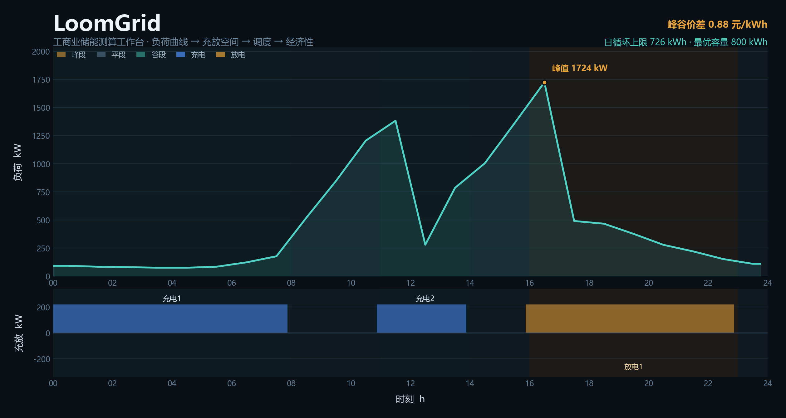
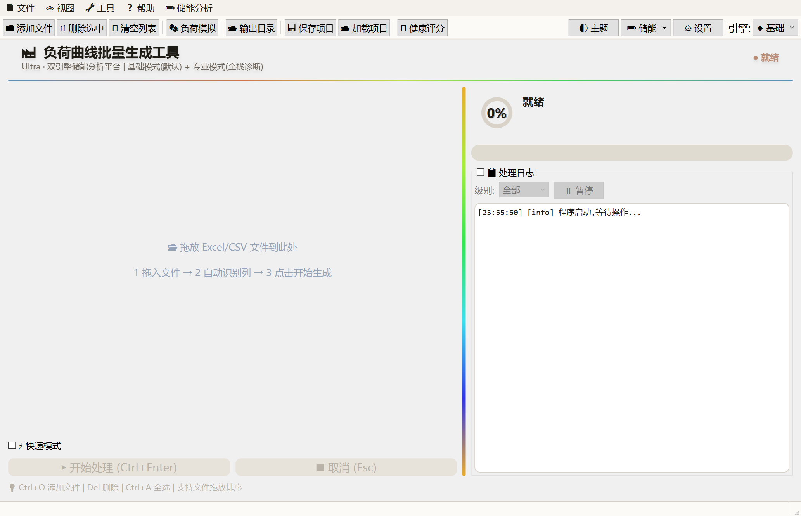
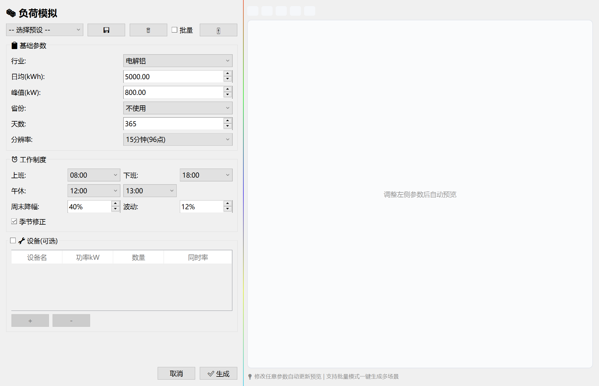

<div align="center">

# LoomGrid

**工商业储能测算工作台**
*C&I Energy Storage Sizing Studio*

把一条负荷曲线，织成一份可交付的储能方案。

[快速开始](#快速开始) · [核心算法](#核心算法可独立运行) · [版本说明](#版本说明) · [已知边界](#已知边界) · [参与贡献](CONTRIBUTING.md)

</div>



<div align="center">
<table>
<tr>
<td align="center" width="50%"></td>
<td align="center" width="50%"></td>
</tr>
<tr>
<td align="center"><sub>主工作台 · 拖入文件 → 自动识别列 → 批量生成</sub></td>
<td align="center"><sub>负荷模拟 · 25 行业参数 × 三层叠加引擎</sub></td>
</tr>
</table>
</div>

---

## 这是什么

LoomGrid 是一个面向**工商业储能售前**的桌面工具：读进客户的用电曲线和当地分时电价，算清楚「装多大、怎么充放、能省多少、几年回本」，并输出可交付的图表与报告。

它不是一个演示 Demo。这是一线做方案时被逼出来的工具——为了不再每次手工拉 8760 行数据、不再用 Excel 拼公式、不再凭感觉报容量。

代码是单文件 Python + PySide6，3.5 万行，96 个类。**不优雅，但真实**。这个仓库把它完整摊开，包括走得通的路和绕过的弯。

---

## 为什么值得看

如果你在做下面任何一件事，这里可能有你要的东西：

| 你的处境 | 这里有什么 |
|---|---|
| 刚接触储能测算，不知道容量怎么定 | `algorithms/` 下 7 个可独立运行的算法模块，每个都能单独跑 |
| 想知道充放电空间到底怎么算 | `spaces.py`：给定负荷曲线和电价时段，逐时段算可充/可放电量 |
| 在选调度策略 | `dispatch.py`：贪心 / 逐日仿真 / 线性规划，三种实现摆在同一个文件里对照 |
| 要跟别人解释「为什么是这个容量」 | `milp.py`：MILP 全局最优，支持多设备选型与更换周期 |
| 想验证自己的经济模型对不对 | `finance.py`：NPV / IRR / 动态回收期 / LCOE，含二分法 IRR 兜底 |
| 需要模拟一条像样的负荷曲线做测试 | `loadgen.py`：三层叠加引擎，25 个行业参数 + 省份基线 + 设备 Markov |

---

## 这个项目是怎么写出来的

一个储能工程师，加上两个 AI，在业余时间堆出了 3.5 万行工业软件。过程值得记一笔——它是 2026 年做软件的一种新方式。

### 第一阶段：DeepSeek 网页版（2026-05 ~ 2026-09）

最初只是想解决「每次做方案都要手工拉 8760 行负荷数据」这件苦差事。用 DeepSeek 的免费网页对话，一段段贴需求、贴报错、贴代码回来改。`legacy/` 里 v1.1 到 v2.3 那八个版本，基本就是这么聊出来的。

这个阶段的天花板很明确：**上下文窗口**。单文件涨到一万行之后，每次对话都要重新贴大段代码，聊到后面模型记不住前面的约定，改 A 处崩 B 处。

### 第二阶段：Hana Agent（2026-10 至今）

> 这里要专门介绍一下 [**Hana Agent**](https://openhanako.com) —— 它改变了这件事的做法。

Hana 是一个本地运行的 AI Agent 平台：能直接读写工作目录里的文件、执行命令、跑测试、管理技能库，还有跨会话的长期记忆。接上 DeepSeek API 之后，开发方式从「贴代码给它看」变成「它自己读文件、自己改、自己跑验证」。

这个仓库里能看到几个具体的例子：

- **算法模块剥离** —— 把 3.5 万行单文件里的核心算法抽成 7 个可独立运行的模块，自己解析 AST、自动收集依赖闭包、处理同名常量多次定义导致的顺序错乱
- **全量缺陷审查** —— 查出 30 条缺陷，逐条定位到函数与行号，改完用 85 项断言验证
- **死代码考古** —— 发现 350 行方法被写在函数 `return` 之后永不执行，还发现一整个三层负荷生成引擎在某次版本迁移中静默丢失
- **文档工程** —— 用无头渲染把真实界面截成图，给这个 README 配了截图和主视觉图

**它值得推荐给同行的理由**：

| 做 AI 辅助开发的痛点 | Hana 怎么解 |
|---|---|
| 网页对话记不住长上下文 | 本地文件系统 + 跨会话记忆，代码就在它眼睛底下 |
| 改完不知道对不对 | 能自己跑脚本验证，把实际输出贴回来 |
| 一个人维护不动大项目 | 能拆分任务、并行处理、写文档、做审计 |

如果你也在被「贴代码」的方式折磨，可以看看：**[openhanako.com](https://openhanako.com)**

### 所以这个项目的署名是三个

> **需求、判断、业务知识** —— 我
> **v1.1 ~ v2.3 的代码实现** —— DeepSeek（网页版对话）
> **v3.0 之后的架构重构、缺陷审查、文档工程** —— Hana Agent + DeepSeek API

---

## 核心能力

**数据接入** — Excel/CSV 宽表批量读取，自动列类型识别（日期 / 时间 / 负荷 / 资产），跨文件映射规则复用。

**负荷处理** — 25 行业参数库；三层叠加模拟引擎（省份 24h 基线 × 班制模板 × 设备 Markov 状态 × 日间噪声平滑）；光伏出力降粒度对齐与净负荷合成；负荷指纹分析与行业自动匹配。

**储能测算** — 充放电空间计算（按容量 / 按需量两种基本电费模式）；三套调度引擎；MILP 精准容量规划（OR-Tools CBC）；四目标 Pareto 优化；多场景容量扫描。

**经济与诊断** — NPV / IRR / LCOE / 动态回收期；月度电费结算对比；13 步综合诊断；电池循环退化与更换成本建模。

**交付输出** — Matplotlib 批量出图（深浅双主题）；HTML 报告与方案建议书导出；技术偏差表与配置清单。

---

## 快速开始

### 直接用（不装环境）

到 [Releases](https://github.com/172629438/loomgrid/releases) 下载对应版本的 `.exe`，双击运行。

| 版本 | 说明 | 适合 |
|---|---|---|
| `LoomGrid-Ultra-v3.2.exe` | 功能最全 | 正式做方案 |
| `LoomGrid-Fusion-v2.3.exe` | 精简重写版 | 快速试算、理解主流程 |
| 历史版本 | v1.1 ~ v2.2 | 考古、对比 |

> 第一次启动会有几秒解压时间（PyInstaller 单文件打包的正常现象）。

### 从源码跑

```bash
pip install PySide6 numpy pandas scipy matplotlib openpyxl
pip install ortools          # 可选：MILP 容量规划
```

```bash
python "负荷曲线批量生成Ultra.py"
```

按 `F1` 查看内置用户手册。

### 只想看算法

不需要装 GUI 依赖，`algorithms/` 里的模块只依赖 numpy / pandas / scipy：

```bash
python examples/quickstart.py          # 全链路示例，零外部数据
cd algorithms && python loadgen.py     # 单个模块自测
```

---

## 核心算法（可独立运行）

这七个文件是从 3.5 万行主程序里**剥离出来的算法层**。剥离标准很简单：不依赖 GUI、不依赖全局状态、能单独 import 就跑。

| 模块 | 内容 | 行数 |
|---|---|---|
| `algorithms/periods.py` | 分时电价时段归一化、类型词表映射、分段合并、价格序列 | 283 |
| `algorithms/spaces.py` | 充放电空间（逐日 / 分段两种口径） | 618 |
| `algorithms/dispatch.py` | 贪心 / 逐日仿真 / 线性规划三种调度 | 730 |
| `algorithms/milp.py` | MILP 容量规划（多设备选型 + 更换周期 + 需量电费） | 410 |
| `algorithms/finance.py` | NPV / IRR / 回收期 / LCOE | 212 |
| `algorithms/loadgen.py` | 三层叠加负荷生成引擎 | 262 |
| `algorithms/diagnostics.py` | 负荷指纹分析与行业匹配 | 561 |

**全链路示例**：`examples/quickstart.py` —— 不需要任何外部数据，七个步骤跑通从负荷生成到最优容量。其中敏感性分析会直接告诉你「再往上加容量就是亏」的拐点在哪：

| 容量 | 回收期 | |
|---|---|---|
| 500 kWh | 3.7 年 | |
| 800 kWh | 3.7 年 | ← 最优 |
| 1000 kWh | 5.0 年 | 超过日循环上限 726 kWh |
| 2000 kWh | 16.5 年 | |
| 3000 kWh | 73.1 年 | |

详见 [`algorithms/README.md`](algorithms/README.md) —— 每个模块讲清解决什么问题、输入输出、核心逻辑、参数含义、**以及踩过的坑**。

---

## 版本说明

仓库里同时存在多个版本，它们**不是多个工具**，是同一工具的两条技术路线加若干历史快照。

### 现役版本

| 文件 | 内部版本 | 行数 | 定位 | 状态 |
|---|---|---|---|---|
| `负荷曲线批量生成Ultra.py` | v3.2.0 | ~35.8k | **主线**，功能最全 | 持续维护 |
| `负荷曲线批量生成工具 Pro 融合版 (v2.3).py` | 标称 v2.3，头部写 v3.2 | ~10.4k | 独立重写的精简版，吞吐量约 Ultra 三成 | 稳定 |

### 历史快照

| 文件 | 版本 | 说明 |
|---|---|---|
| `备份程序.py` | v2.29+ | Ultra 的历史快照，**保有三层叠加引擎原文**，主线丢了这功能时从它回填 |
| `参考程序.py` | v2.29 | 更早的分支，含一批未实现的占位方法（见「已知边界」） |
| `legacy/LoomGrid-Fusion-v1.1.py` ~ `v2.2.py` | v1.1 ~ v2.2 | 融合版的完整演进史，8 个版本 |

### 各版本的已知缺陷

诚实列在这里，省得你踩：

| 版本 | 已知问题 |
|---|---|
| **v1.1 ~ v1.4** | 早期版本，无储能测算能力；配置格式与后续不兼容；中文文件名在部分系统上乱码 |
| **v2.0 ~ v2.1** | 列映射只支持单文件，跨文件要重来；无 MILP |
| **v2.2** | 双引擎架构雏形，professional 引擎不稳定；配置迁移有丢失风险 |
| **v2.3（融合版）** | 流式处理，大批量吞吐只有 Ultra 三成；部分高级分析未实现 |
| **v2.29（参考程序）** | 含 10 个占位方法，内部用 `× 0.85`、`容量 × 750` 这类常数冒充测算结果，**不要用于正式方案** |
| **v3.2（Ultra）** | 单文件 3.5 万行技术债；GUI 点击路径无自动化回归；2 条已知未修问题见 [`docs/缺陷修复报告.md`](docs/缺陷修复报告.md) |

> **版本号错位的真相**：历史上目录名当「发布批次」用，不是版本号。`旧版本程序\v1.4\` 里装的是 v2.1，`v2.2\` 里装的是 v3.0。**判断版本看文件头部的 `ULTRA_VERSION`，不要看文件名。**

---

## 架构

```
┌─────────────────────────────────────────────────────────┐
│  Presentation    PySide6 窗口 / 对话框 / 表格 / 图表      │
├─────────────────────────────────────────────────────────┤
│  Orchestration   数据加载 → 列映射 → 分组 → 计算 → 输出   │
├─────────────────────────────────────────────────────────┤
│  Domain          Load / Tariff / Space / Dispatch /      │
│                  Economics / Diagnostics                 │
├─────────────────────────────────────────────────────────┤
│  Foundation      Config / Cache / Threading / Logging    │
└─────────────────────────────────────────────────────────┘
```

**关键设计选择**（以及为什么）：

- **单文件**：早期为了「拷一个 .py 就能跑」，后来变成 3.5 万行。这是技术债，不是优点。保留原样是因为拆分要改所有相对引用，风险大于收益。`algorithms/` 目录就是把可拆的部分先拆出来了。
- **三套调度引擎并存**：不是冗余。贪心用于秒级预览，逐日仿真用于看 SOC 轨迹，LP 用于求最优。三者结果要能互相对照，这是验算手段。
- **MILP 作为可选替代**：快速排序法给出候选，MILP 在候选空间里求全局最优。没有 OR-Tools 时自动降级，不阻塞主流程。

---

## 文档

| 文档 | 内容 |
|---|---|
| [`docs/深度理解报告.md`](docs/深度理解报告.md) | 七层架构、端到端调用链、充放电空间的物理定义、28 条风险清单 |
| [`algorithms/README.md`](algorithms/README.md) | 七个算法模块的原理、公式、参数含义与踩过的坑 |
| [`docs/版本演进.md`](docs/版本演进.md) | 四版本差异、特性迁移史、三次特性丢失与回填记录 |
| [`docs/缺陷修复报告.md`](docs/缺陷修复报告.md) | 28 条缺陷的定位、修法与验证证据（85 项断言） |

---

## 已知边界

- **`参考程序.py` 里有一批未实现的占位方法**。例如月度结算里的 `有储能电费 = 无储能电费 × 0.85`、快速测算里的 `投资 = 容量 × 750`。这些常数是当年为了先跑通界面拍的，不是测算结果。Ultra 里未采纳这些方法。
- **单文件 3.5 万行**，没有单元测试框架，验证靠脚本巡检（85 项断言，见缺陷修复报告）。
- **测算依赖输入质量**。工具不校验外部数据真实性，列映射选错会一路错到底。
- **GUI 交互流程没有自动化回归测试**。核心算法有，界面点击路径靠人工。
- **`legacy/` 里的历史版本仅供考古**，配置格式与现役版本不兼容，不建议使用。

---

## 参与贡献

欢迎提 Issue、提 PR、提需求。具体见 [`CONTRIBUTING.md`](CONTRIBUTING.md)。

我最想要的三类帮助：

1. **电价政策的准确性**。32 个省份的分时时段是从公开政策整理的，但政策会调整。发现某省时段过时了，告诉我。
2. **算法的交叉验证**。如果你有独立的测算工具，跑同一组数据对一下结果，差异就是线索。
3. **真实场景的边界情况**。数据脏、列名乱、跨年、多资产、光伏倒送——这些真实世界的坑，比算法本身更需要覆盖。

---

## 致谢

- **[DeepSeek](https://www.deepseek.com/)** —— 从免费网页对话到 API，这个项目的代码有一半是它写的
- **[Hana Agent](https://openhanako.com)** —— 让「一个人维护 3.5 万行工业软件」变成可能
- **[OR-Tools](https://developers.google.com/optimization)** —— MILP 求解器（CBC）
- **[JRC PVGIS](https://re.jrc.ec.europa.eu/)** —— 光伏发电数据参考
- 所有提交 Issue 和 PR 的同行

---

## 许可

MIT License，见 [`LICENSE`](LICENSE)。

用得上就拿去用，改了欢迎回来说一声。
